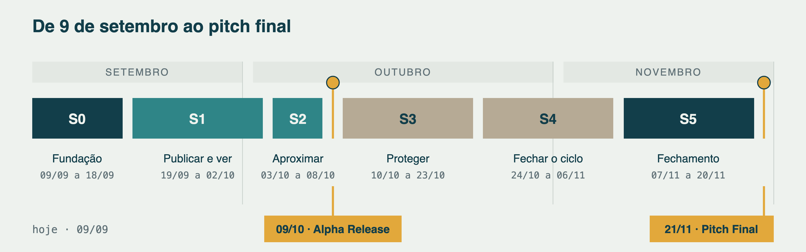

# Cronograma do Projeto: Achei um Bicho

**Disciplina:** Laboratório de Desenvolvimento de Software · UFOPA
**Professora:** Carla Marina C. Paxiúba
**Equipe:** Bruna Kellen · Murilo Falcão · Rafael Nobre
**Versão:** 1.1, de 9 de setembro de 2026

---

## 1. Os três marcos da disciplina

O plano de aula fixa três datas. Elas não se movem, e entrega fora do prazo vale
zero.

| Data | Marco | O que a disciplina cobra | Situação |
|---|---|---|---|
| 28/08/2026 | Kickoff Técnico | Equipe formada, desafio escolhido, funcionalidades do MVP definidas e pelo menos 5 telas de protótipo de média fidelidade | Entregue: 7 telas e 2 estados |
| 09/10/2026 | Alpha Release | Primeira versão do sistema rodando, apresentada | A fazer |
| 21/11/2026 | The Final Pitch | Versão final rodando, código-fonte, documentação e artigo em formato SBC | A fazer |

Entre esses três encontros não há aula. O ritmo interno passa a ser
responsabilidade da equipe, e é isso que torna o atraso perigoso: ele não aparece
até a véspera. O resto deste documento existe para abrir essas três datas em algo
que possa ser conferido toda semana.

## 2. Quanto tempo sobrou

Contando a partir de 9 de setembro, faltam 30 dias para o Alpha Release e 73 para
o Pitch Final. Em semanas úteis, pouco mais de quatro e pouco mais de dez.

O trecho apertado é o primeiro. Das quatro semanas até o alpha, a primeira e meia
é fundação, sem código de produção nenhum. A escolha é deliberada: fundação
malfeita cobra juros em outubro, quando já não há tempo para pagar.

## 3. Semana a semana

A tabela abaixo abre os três marcos da professora em onze semanas. É o documento
que a equipe consulta na reunião semanal.

| # | Período | Foco | O que precisa estar pronto no fim da semana |
|---|---|---|---|
| 1 | 09/09 a 13/09 | Fundação | Documento de visão, modelo ER e cronograma aprovados pela equipe |
| 2 | 14/09 a 20/09 | Fundação | Repositório no GitLab, monorepo, Docker subindo Postgres com PostGIS, prova de conceito da consulta por raio |
| 3 | 21/09 a 27/09 | Publicar | F1 e F2 no servidor, com testes; primeiras telas do aplicativo consumindo a API |
| 4 | 28/09 a 04/10 | Ver | F3 e F4 funcionando de ponta a ponta; build do aplicativo instalável num celular real |
| 5 | 05/10 a 11/10 | **Alpha em 09/10** | F5 pronto, dados de demonstração criados, roteiro ensaiado |
| 6 | 12/10 a 18/10 | Proteger | Perguntas de verificação e fluxo de reivindicação (F6) |
| 7 | 19/10 a 25/10 | Proteger | Liberação de contato (F7) com teste automatizado de vazamento |
| 8 | 26/10 a 01/11 | Fechar o ciclo | Estados, desfecho e tarefas agendadas (F8) |
| 9 | 02/11 a 08/11 | Fechar o ciclo | Fila offline (F9), suíte de testes completa, primeira rodada com protetores |
| 10 | 09/11 a 15/11 | Congelamento | Correções da rodada com protetores; artigo SBC em rascunho completo |
| 11 | 16/11 a 22/11 | **Pitch em 21/11** | Artigo revisado, documentação conferida, vídeo de reserva, dois ensaios cronometrados |

## 4. As sprints em detalhe

### Sprint 0 · Fundação · 09/09 a 18/09

Nenhuma linha de código de produção nesta sprint. Ela existe para que as
seguintes não precisem adivinhar nada.

| Entrega | Como se sabe que terminou | Responsável |
|---|---|---|
| Documento de visão | Aprovado pelos três em reunião | a definir |
| Modelo ER e esquema físico | Script SQL roda sem erro num banco vazio | a definir |
| Casos de uso e diagrama de classes | Diagramas versionados no repositório | a definir |
| Repositório estruturado | Qualquer integrante clona e encontra a estrutura pronta | a definir |
| Contêiner com Postgres e PostGIS | Um comando sobe o banco já com as tabelas criadas | a definir |
| Prova de conceito da consulta por raio | A consulta espacial retorna os casos ordenados por distância, usando índice | a definir |
| Vocabulário fechado com fonte única | Os tipos da aplicação e as restrições do banco derivam da mesma declaração | a definir |
| Modelo de configuração das duas aplicações | Nenhuma senha ou chave versionada | a definir |

A prova de conceito do PostGIS entra logo na primeira sprint por um motivo:
é a única parte da stack que ninguém da equipe já usou. Descobrir problema com
ela em outubro seria descobrir tarde.

### Sprint 1 · Publicar e ver · 19/09 a 02/10

O primeiro caminho completo do produto: publicar um caso e vê-lo aparecer no
mural de outro aparelho.

| Entrega | Funcionalidade | Critério |
|---|---|---|
| Cadastro de caso perdido, com atributos, local e perguntas de verificação | F1 | Publicação completa em no máximo 4 passos |
| Cadastro de caso encontrado, sem conta, com código de edição | F2 | Conclui sem informar e-mail ou senha |
| Consulta por raio no banco, com índice espacial | F3 | O plano de execução confirma o uso do índice espacial |
| Mural com filtro e raio ajustável | F3 | Distância em metros confere com o mapa |
| Tela de caso aberto | F4 | Nenhum dado de contato aparece na resposta da API |
| Build do aplicativo e deploy da API | — | Aplicativo instalado num celular da equipe |

Testes obrigatórios: unidade nas regras de publicação, e integração da consulta
por raio contra um Postgres real em contêiner.

O item que costuma ser adiado e não pode ser é o último. Build e deploy precisam
existir enquanto o aplicativo ainda está vazio, porque é quando quebrar custa
barato.

### Sprint 2 · Aproximar · 03/10 a 08/10

Seis dias, e é a sprint que fecha o alpha. Escopo mínimo por decisão.

| Entrega | Funcionalidade |
|---|---|
| Registro de avistamento | F4 |
| Gerador de pareamentos, determinístico | F5 |
| Tela de pistas, com o que bateu e o que não bateu | F5 |
| Dados de demonstração e roteiro ensaiado | — |

Critério de pronto: publicar um caso do lado "achei" e ver o pareamento aparecer
no caso "perdi" correspondente, com a lista de atributos coincidentes correta.

> **09/10 · ALPHA RELEASE.** F1 a F5 rodando com dados criados pela equipe. Se
> alguma coisa não estiver pronta, apresenta-se o que existe. Slide no lugar de
> sistema é pior que funcionalidade faltando.

### Sprint 3 · Proteger · 10/10 a 23/10

| Entrega | Funcionalidade |
|---|---|
| Fluxo de reivindicação e resposta às perguntas | F6 |
| Decisão do autor e liberação de contato | F7 |
| Registro de quem viu o quê, para auditoria | F7 |

Critério de pronto: alguém reivindica, responde as três perguntas, o autor do
caso vê as respostas, e nenhum dado de contato aparece antes da liberação. Isso
se verifica com teste automatizado sobre o corpo da resposta da API, não olhando
a tela.

### Sprint 4 · Fechar o ciclo · 24/10 a 06/11

| Entrega | Funcionalidade |
|---|---|
| Estados do caso e desfecho obrigatório | F8 |
| Tarefas agendadas de cobrança (9 dias) e expiração (15 dias) | F8 |
| Fila de envio offline no aparelho | F9 |
| Suíte de testes completa | — |
| Primeira rodada com protetores locais | — |

Critério de pronto: um caso sem interação é cobrado e expira sozinho, sem
ninguém rodar nada à mão.

A rodada com protetores fica nesta sprint, e não na última, porque o que ela
revelar ainda precisa caber em algum lugar do calendário.

### Sprint 5 · Fechamento · 07/11 a 20/11

Nenhuma funcionalidade nova. Quem abrir escopo aqui atrasa o pitch.

As entregas são cinco: as correções do que a rodada com protetores revelou, o
artigo em formato SBC escrito e revisado, a documentação conferida contra o
código que existe de fato, um vídeo curto de demonstração para o caso de a
internet cair no dia, e dois ensaios do pitch, cronometrados.

> **21/11 · THE FINAL PITCH.** Sistema rodando, código-fonte, documentação e
> artigo entregues.

## 5. Como a equipe se organiza

Reunião de controle toda semana, dia e hora fixos, trinta minutos. Três
perguntas: o que ficou pronto, o que travou, o que muda no plano. Como não há
aula semanal, esse encontro é o único mecanismo que revela atraso a tempo.

As trilhas abaixo são sugestão; a alocação de nomes fica com a equipe.

| Trilha | Escopo |
|---|---|
| Aplicativo | Telas, navegação, fila offline, consumo da API |
| API e banco | Módulos NestJS, migrations, consulta espacial, tarefas agendadas |
| Dados e documentação | Modelagem, UML, artigo SBC, conversas com protetores |

Ninguém fica dono exclusivo de uma trilha. Toda entrega passa por revisão de
outra pessoa antes de entrar na branch principal, e quem escreveu não revisa o
próprio código.

Uma regra de trabalho não se negocia: nenhuma linha de código de produção antes
do teste que ela faz passar, e o teste precisa ser visto vermelho antes de verde.

## 6. Riscos

| Risco | Impacto | O que fazer antes que aconteça |
|---|---|---|
| Build do aplicativo e deploy da API escorregarem para outubro | Alto: o alpha vira slide | Subir os dois na Sprint 1, com o aplicativo ainda vazio |
| PostGIS levar mais tempo que o previsto para aprender | Médio | Prova de conceito da consulta por raio na Sprint 0 |
| Sprint 2 ter só seis dias | Alto | Nada de escopo novo nela; o que não couber na Sprint 1 fica fora do alpha |
| Mural vazio na demonstração | Alto: o produto parece não funcionar | Fechar dois protetores parceiros até o fim de setembro |
| Artigo deixado para novembro | Alto | Escrever a fundamentação teórica ainda em setembro |
| Uma pessoa sobrecarregada | Médio | A revisão cruzada obrigatória expõe o desequilíbrio cedo |
| Escopo crescer na Sprint 5 | Alto | A Sprint 5 é congelada por definição |

## 7. O que sai primeiro se apertar

Ordem de construção: F1, F3, F2, F4, F5, F8, F6, F7, F9.

Se o prazo apertar, F9 (publicação offline) é a primeira a sair, e é a única que
sai sem quebrar a história do produto. F6 e F7 ficam de qualquer jeito: sem elas
o sistema não tem resposta para como impedir que alguém leve o animal de outra
pessoa.
